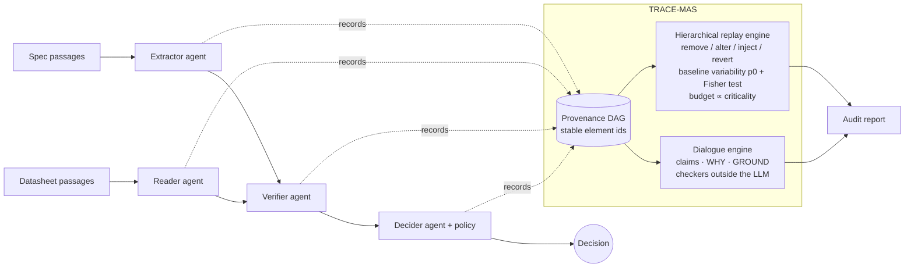

# TRACE-MAS — replay-verified, requirement-linked explanations for multi-agent LLM chains

> **Question.** In a chain of LLM agents where each step builds on the previous ones, *which information actually determined the
> final decision, which requirements does it involve, and can an auditor check that claim against the system's behaviour?*

TRACE-MAS is a research prototype that (1) captures every execution of a requirements-driven multi-agent chain in a
**PROV-style provenance graph**, (2) explains a decision by **controlled perturbation and replay** (removal, counterfactual
alteration, error injection) *measured against the system's natural non-determinism*, (3) scales the amount of evidence with
**requirement criticality**, and (4) imposes a **dialogue protocol** (argument schemes + critical questions, checked outside the
LLM) whose structured claims complement the replays. It is explicitly about the **observable decision process**, not the internal
reasoning of LLMs.



## Quick start
```bash
pip install -e ".[dev]"        # no runtime dependency; matplotlib optional (figures), anthropic optional (real LLM)
make test                      # 37 tests
python -m tracemas demo --seed 11 --inject --out out   # chain + explanation + dialogue + audit report on one case
python -m tracemas benchmark --out results             # experiments E1–E4 (~2 min)
dot -Tpng out/provenance.dot -o out/provenance.png     # provenance graph, decisive elements highlighted
```
Real model instead of the simulator: `pip install anthropic && ANTHROPIC_API_KEY=... python -m tracemas demo --backend anthropic`
(model via `TRACEMAS_MODEL`). Any object with `complete(task, payload, key, seed)` can be plugged in (`tracemas/llm.py`).

## What the audit report looks like
`results/demo/audit_report.md` (case with an injected hallucinated requirement that flips the decision) lists the decisive
requirements with criticality, effect over baseline + Wilson CI, the perturbation that revealed them, the status of the claims
about them, whether the agent's own textual justification matches the replay-verified explanation, and flags
**decisive ∧ refuted** requirements as prime suspects.

## Results (simulated agents — see scope below)

#### E1 — Faithfulness vs noise-free ground truth (requirement-level)

| method | precision | recall | F1 | exact | avg #groups | avg replays |
|---|---|---|---|---|---|---|
| text_justification | 0.896 | 0.843 | 0.837 | 0.792 | 3.875 | 1 |
| provenance_ancestors | 0.475 | 1.0 | 0.579 | 0.0 | 10 | 1 |
| replay_flat | 0.75 | 0.75 | 0.75 | 0.75 | 4.25 | 1734 |
| replay_hier_uniform | 1.0 | 1.0 | 1.0 | 1.0 | 4.75 | 543.917 |
| replay_hier_crit | 1.0 | 1.0 | 1.0 | 1.0 | 4.75 | 512.75 |

### E2 — Localising an injected (hallucinated) requirement (40 wrong decisions)

| method | hit-rate | avg #groups flagged | precision if hit | avg replays |
|---|---|---|---|---|
| text_justification | 0.725 | 2.175 | 0.561 | 1 |
| provenance_ancestors | 1.0 | 10 | 0.1 | 1 |
| replay_flat | 1.0 | 2.45 | 0.806 | 1748 |
| replay_hier_uniform | 1.0 | 2.45 | 0.806 | 387.75 |
| replay_hier_crit | 1.0 | 2.45 | 0.806 | 373.05 |
| dialogue_refutation | 1.0 | 1.7 | 0.729 | 0 |

### E3 — Natural variability vs noise level

| noise ×| natural flip rate p0 | F1 (replay_hier_crit) | replays |
|---|---|---|---|
| 0.0 | 0.0 | 1.0 | 431.3 |
| 0.5 | 0.073 | 1.0 | 542.7 |
| 1.0 | 0.104 | 0.994 | 649.1 |
| 2.0 | 0.224 | 0.994 | 728 |
| 3.0 | 0.276 | 0.859 | 676.3 |

### E4 — Dialogue protocol (burden of proof ∝ criticality)

- extraction errors refuted: 8, missed: 7, false refutations: 0, recall: 0.533
- recall by criticality (errors in C-claims are deliberately unchallenged): {'A': 1.0, 'B': 1.0, 'C': 0.0}
- moves per claim by criticality: {'A': 7.88, 'B': 5.97, 'C': 2}
- protocol violations found by external conformity check: 0

**Reading the numbers (honest summary).**
* The agent's **textual justification is unfaithful by construction in 30 % of decisions** in the simulator (as LLM
  justifications can be, cf. Turpin et al. 2023); it localises an injected error only ~73 % of the time. Provenance alone is
  complete but not selective (all upstream elements). Replay-based explanations recover the ground truth.
* **Flat single-element ablation fails on overdetermined decisions** (two independent failing critical requirements): the
  sufficiency-alone step is what fixes it (`tests/test_tracemas.py::test_redundant_causes_*`).
* **Hierarchical + sequential testing cuts replays by ~3–4×** vs flat. The criticality-aware budget gives a further, modest
  saving (~8 %) here; it matters more when many low-criticality requirements exist.
* **Natural variability matters**: F1 stays ≈1 up to p0≈0.2 and degrades at p0≈0.28 (E3) — perturbation results must not be
  interpreted without measuring it.
* The dialogue refutes hallucinated extractions at no replay cost, but **only where the burden of proof requires challenging**
  (A/B); C-level claims are deliberately unchallenged. It also revealed a protocol hole (evidence switching between critical
  questions) during development, now closed by a commitment-consistency rule and a regression test.

## Scope and limits (please read)
* Agents are **simulated** with configurable noise and injected unfaithfulness; this validates the *method and its cost/variability
  behaviour*, **not** real-LLM faithfulness. Real-model experiments are the immediate next step (`AnthropicLLM` backend is provided,
  untested at scale here).
* Synthetic threshold-type requirements; industrial documents are messier (cross-references, units, conditional requirements).
* Criticality is modelled; **severity** of errors (distinct from criticality) is not yet.
* RQ4 (does the explanation improve *audit*, not just trust?) needs a user study and is not covered.

## Roadmap
1. Real LLM agents on public requirements corpora (e.g. standards/specs with tracked requirement–test links); measure p0 at temperature 0.
2. Richer element granularity (sentence/span level) and approximate attribution (grouped / Shapley-style ablations) to cut replay cost further.
3. Severity-aware evidence levels; sequential testing with adaptive budgets.
4. Study protocol: engineers audit decisions with {original chain, provenance, textual justification, TRACE-MAS}; measure
   error-detection rate, time, and *calibrated* trust (not only trust).
5. Formal semantics for the dialogue (commitment store, termination, burden-of-proof lattice) and LLM proponents.

## Repository layout
```
tracemas/  types · parsing · corpus (synthetic cases + gold) · llm (simulator, Anthropic adapter) · pipeline (chain + provenance + interventions)
           stats (Fisher, Wilson) · explain (hierarchical replay explainer, oracle) · dialogue (protocol engine) · provenance · report · bench · cli
tests/     37 tests (oracle agreement, overdetermination, cost, injection localisation, protocol admissibility/conformity, regression)
docs/      METHODOLOGY.md · RESEARCH_MAPPING.md
results/   results.md/json, e1.png, demo/ (audit report, PROV-JSON, DOT)
```

## References
Souza et al. (2025) PROV-AGENT · Turpin et al. (2023) Language Models Don't Always Say What They Think · Zhang et al. (2025) Which Agent
Causes Task Failures and When? · Zhang et al. (2026) AgenTracer · Walton & Krabbe (1995) Commitment in Dialogue · Walton, Reed & Macagno (2008)
Argumentation Schemes.

MIT licensed. Author: Mohammed-Amine Salhi.
